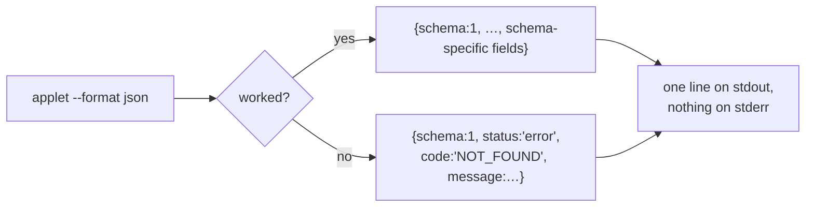

Every direct-call applet now takes `--format json` and answers with one line containing `"schema":1`; a failure answers with the same envelope, so agent tooling can parse success and error the same way. 84 conformance checks (sweep §21–23) assert this for all 14 applets on darwin and linux.



## The envelope

```
$ busybox json -f /nope --format json
{"schema":1,"status":"error","code":"NOT_FOUND","message":"No such file or directory"}
$ busybox snapshot -d /nope -F json
{"schema":1,"status":"error","code":"NOT_FOUND","message":"No such file or directory","dir":"/nope"}
```

`code` comes from the §2 list where one fits (`NOT_FOUND`, `INVALID_ARGUMENT`, `TIMEOUT`, …); `bench` adds `EXIT_NONZERO` because a timing run that fails is not one of those. `waitfor` carries `status:"ok"|"error"` beside `ready` and its `code`. `why` adds `status` and, when nothing resolved, `code:"NOT_FOUND"` with exit 1.

## What changed to get there

- `column` gained `--format json`: `{"schema":1,"rows":2,"cols":3,"data":[["a","b","c"],["d","ee","f"]]}` — the parsed table, so an agent never guesses column widths.
- `json`, `check` and `brief` previously printed only text to stderr when the file could not be opened; they now emit the envelope (and `brief`/`column` open silently in JSON mode so stderr stays empty).
- `snapshot` reported a missing directory as `{"status":"ok","count":0}` with exit 0 — now `NOT_FOUND`, exit 1. **A path that does not exist is not an empty tree.**
- `patchcheck` and `brief` gained `message`; `bench` gained `code`; `why` and `waitfor` gained `status`.
- `peek` and `brief` documented their `--format` long option (it existed; the usage text only showed `-f`/`-F`).

## Checking it stays true

`tests/agent-ops-sweep.sh` §21 runs each applet twice — a working invocation and a failing one — and asserts: `"schema":1`, one line, `status:"error"` plus a `code` on failure, and zero bytes on stderr. §22 covers `column`'s table, §23 the corrected snapshot/patchcheck/bench/waitfor fields.

One gap outside this change: `src/miscutils/check.c` still has **no patch file** in `patches/`, so its edits live only in the working tree. Land it before the next release build.
