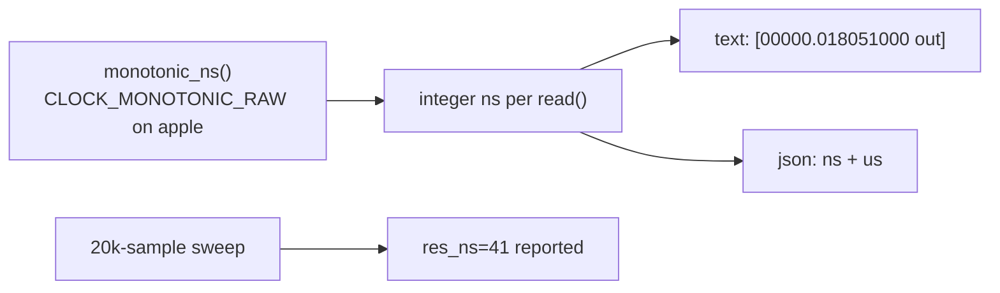

`run -t -n` / `sh --stamp-ns` stamp each line from a nanosecond clock and report the clock's real granularity. Verified on the Darwin host, in an AlmaLinux container, and on the UTM `alma9-vm` (Linux 5.14 aarch64): **resolution 41 ns on darwin and 41–45 ns on linux**, monotonic in every run, and the numbers can be checked rather than trusted.



## What was built

- `libbb/time.c`: `get_mono()` now uses **`CLOCK_MONOTONIC_RAW` on Apple** (its `CLOCK_MONOTONIC` stops during sleep) and `CLOCK_MONOTONIC` elsewhere. `monotonic_ns()` already existed and is unchanged.
- `coreutils/run.c`: the timeline stores integer **nanoseconds** since fork (was µs), renders `[%05llu.%09llu out]` with a hand-written writer, and takes one clock read per `read()` — not per line, which would invent precision.
- `-n, --stamp-ns` selects 9 digits; the default stays 6 for compatibility. `sh --stamp-ns` forwards and implies `--timestamps`.
- The header and JSON declare the measurement: `stamp=ns res_ns=41` and `"stamp_ns":true,"stamp_res_ns":41`. JSON carries both `"ns":…` and `"us":…`.

## Verification, on the machines asked for

| host | clocksource | res_ns | 200 stamps non-decreasing | 9-digit field |
|---|---|---|---|---|
| darwin host (Apple Silicon) | 24 MHz timer | **41** | yes | yes |
| UTM `alma9-vm` (Linux 5.14) | `arch_sys_counter` | **45** | yes | yes |
| alma container (musl static) | `arch_sys_counter` | **41** | yes | yes |

```
darwin:  [00000.018051000 out] one   [00000.018124292 err] two
alma9-vm:[00000.002980385 out] a     [00000.003014284 err] b      res_ns=45
```

The smallest positive delta between real lines was ~6.6 µs on the VM and ~8.4 µs on the host — those are the intervals the child actually produced, not the clock's floor. The floor is the reported `res_ns`.

## The `res_ns` probe

Twenty thousand consecutive reads, keep the smallest non-zero difference: 41 ns on a 24 MHz counter, which matches the tick exactly. It costs about 0.5 ms once per run and only when `-n` is used.

## Suites

`tests/agent-ops-sweep.sh` §24b, 15 checks: header says `stamp=ns`, `res_ns < 1000`, 9 digits on every line, timestamps non-decreasing, `-n` implies a timeline, 6 digits still the default, JSON has `stamp_ns`/`stamp_res_ns`/`ns`/`us`, and `sh --stamp-ns` forwards while `sh -c 'echo --stamp-ns'` stays literal.

`sweep 1267/0` · `deep 1036/0` · `brief 910/0` · `agent-ops 1299/0` (darwin); `sweep 1267/0` in the container.

## A mistake worth recording

`pgrep -f 'sleep 5'` matched an unrelated `sleep 540` from another session, which made `run.timeout.kills.child` fail for a reason that had nothing to do with this change — and a follow-up `pkill -f 'sleep 5'` then killed that other session's `run --timeout 700` wrapper. Both suites now use a per-run sentinel (`sleep 5; : sentinel-$$`). **Never pattern-kill on a substring that a longer-lived process can contain**, and never `pkill -f` from a shell whose own command line contains the pattern.
