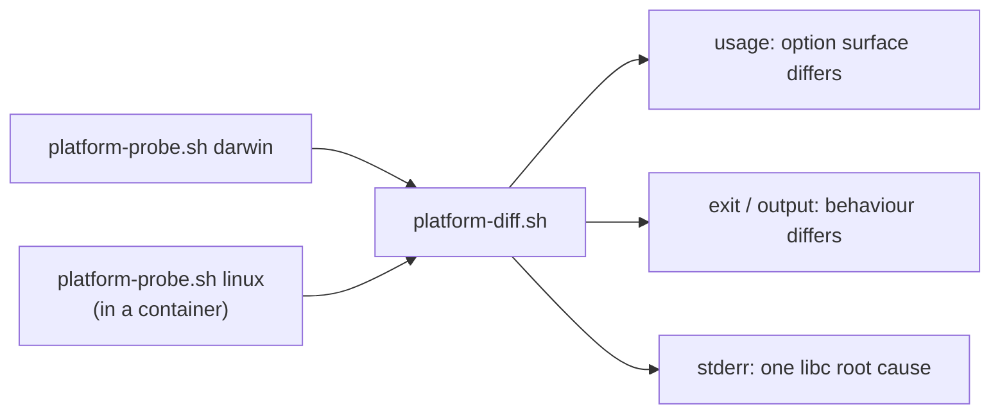

An option-level audit of two binaries built from this one tree finds **514 comparable probes: 329 identical, 4 genuine option-surface differences, 3 exit-code differences, 3 output differences, and 174 stderr differences that all reduce to one root cause** — the platform libc's unknown-option wording. The audit is mechanical: `tests/platform-probe.sh` dumps what a binary does, `tests/platform-diff.sh` classifies every difference.



## Run it

```sh
./tests/platform-probe.sh build/deep-darwin/busybox > /tmp/darwin.probe
docker run --rm -v "$PWD:/w:ro" almalinux:9 \
	bash /w/tests/platform-probe.sh /w/build/deep-linux-arm64/busybox > /tmp/linux.probe
./tests/platform-diff.sh /tmp/darwin.probe /tmp/linux.probe
```

Each probe line is `<applet> <probe> rc=<n> out=<sha256> err=<first stderr line>`, normalised for the binary path, the temp dir, floats and long numbers, and with the `BusyBox v…` banner deleted — that banner's build timestamp is the only guaranteed difference between two builds and would otherwise poison every comparison.

## What the audit found

| class | count | meaning |
|---|---|---|
| identical | 329 | same bytes, same status |
| stderr | 174 | **one** cause: unknown-option diagnostics |
| usage | 4 | `fdisk`, `ip`, `mkpasswd` — real option-surface differences |
| exit | 3 | `add-shell`, `lsscsi`, `remove-shell` |
| output | 3 | `arch`, `lsof`, `lsusb` |

The 174 stderr differences are not 174 problems:

```
darwin: busybox: unrecognized option `--nosuch-option-xyz'
linux:  cat: unrecognized option: nosuch-option-xyz
```

Different program name (the multicall binary vs the applet), different quoting, and the `--` prefix dropped — because the message comes from the platform's getopt, not from busybox. **Normalising that one message in busybox's own parser would remove 164 of the 174 stderr diffs and every diff of this class at once.**

## Priority for compat work, highest value first

1. **Own the unknown-option message.** One code path, kills 164 probes' worth of divergence, and makes stderr parseable identically. Cheap.
2. **`pgrep -x` / `pkill -x` on Darwin** (separate finding): the walker hands back a pre-joined argv, so whole-name match never succeeds — `pkill -x` silently kills nothing. Both platforms could agree on "match argv[0]".
3. **`fdisk`, `ip`, `mkpasswd` usage text.** Four probes; these are genuine config-gated option differences, so the fix is either enabling the missing features or diverging the usage text on purpose.
4. **`add-shell`, `remove-shell`, `lsscsi` exit codes** on a bad option: darwin exits 1, linux 0. Usage errors should be 2 on both.
5. **`arch`, `lsof`, `lsusb` output** on a bad option.

## What this audit does not cover yet

Phase B is mostly `--help` over fixtures; it proves the option *surface*, not deep behaviour. Live-process probes (phase C: `ps`, `pgrep`, `pidof`, `killall` against a spawned process) are wired but were only calibrated on darwin — the helper must symlink a real applet name (`sleep`), not an arbitrary one, or busybox answers "applet not found". Treat phase C as the template for the next pass: one spawned process per procps applet, one probe per flag, run on both sides.
