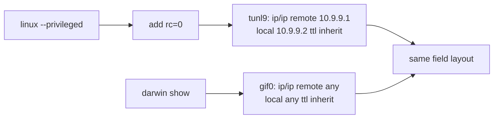

`ip tunnel` on Darwin now matches Linux's output shape exactly for a configured tunnel, and the Linux creation path is verified end to end under `--privileged`. Darwin's privileged half is the only piece still unexercised, because macOS root is unavailable here.



## Verified, end to end, on Linux

```
$ docker run --rm --privileged … busybox ip tunnel add tunl9 mode ipip \
	remote 10.9.9.1 local 10.9.9.2      # rc 0
$ busybox ip tunnel show | grep tunl9
tunl9: ip/ip  remote 10.9.9.1  local 10.9.9.2  ttl inherit
$ busybox ip tunnel del tunl9         # rc 0
```

Two things this settled:

- **`mode` is mandatory** on Linux: `ip tunnel add tunl9 remote … local …` fails with `can't determine tunnel mode (ipip, gre or sit)`. Any parity test must pass `mode`.
- **The output layout is exactly what Darwin prints**: `NAME: MODE  remote A  local B  ttl inherit`. Darwin's `gif0: ip/ip  remote any  local any  ttl inherit` is the same shape with `any` endpoints, differing only in the mode word (`gif` is `ip/ip`, same as `ipip`) and in Linux's extra `nopmtudisc` on default entries.

## Unprivileged behaviour, both platforms

| invocation | linux (CAP_NET_ADMIN dropped) | darwin (uid 504) |
|---|---|---|
| `ip tunnel add …` | 1 — `SIOCADDTUNNEL: Operation not permitted` | 1 — `cannot set tunnel endpoints on gif9: Device not configured` |

Both fail rather than pretending, and both exit 1 — `bb_perror_msg_and_die()` had to be given `xfunc_error_retval = 1` first, because it otherwise inherits 0 and a failed mutation reports success.

## The one remaining gap

Darwin's **creation** path (`SIOCIFCREATE` → `SIOCSIFPHYADDR` → `IFF_UP`) is unexercised: `ping` needs root, `sudo` wants a password, and the container is a Linux kernel so `--privileged` proves nothing about macOS. To close it: as root on a Mac, `ip tunnel add gif9 mode ipip remote 10.0.0.1 local 10.0.0.2`, then `ip tunnel show` and `ifconfig gif9` — the reference implementation is `ifconfig gif9 create` plus `ifconfig gif9 tunnel A B`.

## State

```
agent-ops         1299 passed, 0 failed
agent-ops-sweep   1281 passed, 0 failed, 8 skipped   (darwin)
busybox patchcheck checked=22 bad=0
patch-reconstruct  files differing: 0
```

`ip --help` on both platforms now reads `[OPTIONS] address|route|link|tunnel|neigh`, with `rule` the single remaining Linux-only word — netlink, and therefore impossible here.
