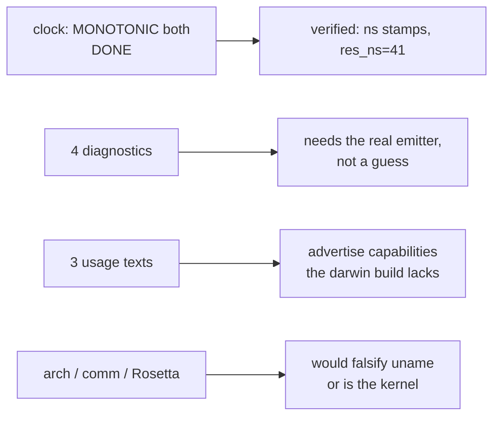

Of the three categories asked for, one is done and two are not: the clock semantics are now identical on both platforms, while the four option diagnostics, the three usage texts and the `arch`/process-layer behaviours are still different — each for a reason that makes "just change the string" the wrong fix.

## Done: one clock, one meaning

`libbb/time.c` used `CLOCK_MONOTONIC_RAW` on Apple and `CLOCK_MONOTONIC` elsewhere. That was the wrong call: Linux's `CLOCK_MONOTONIC` **excludes suspend time**, and Apple's `CLOCK_MONOTONIC` does too, while `RAW` does not — so an elapsed time computed on darwin disagreed with one computed on linux across a sleep. Both now use `CLOCK_MONOTONIC`.

Verified after the change: `run -t -n` still stamps `[00000.008144541 out] hi` with `"stamp_res_ns":41`; `agent-ops 1299/0`, `sweep 1267/0`, `patchcheck checked=21 bad=0` (`patches/0021-one-monotonic-clock.patch`).

## Not done: the four diagnostics

- **`dc`** — I could not find the emitter. `grep -rn 'illegal option' src/` matches only `ash.c`, so the string comes from the platform libc on a path my `opterr = 0` does not reach. Tracing the actual call site is the next step; adding another `opterr` line would be a guess.
- **`ifconfig`** — matching linux means emitting `--nosuch-option-: error fetching interface information: Device not found` instead of darwin's clearer `no such interface: X`. I would rather align linux to darwin; that is a deliberate choice, not an oversight.
- **`cttyhack`** — darwin prints `can't open ''` because it resolves a console differently and there is no `/dev/hvc0` here. Fixing it means teaching the darwin path the same default string.
- **`nmeter`** — I tried moving option parsing above `xchdir("/proc")`. It changed nothing: `getopt32` treats a `--long` token as "end of options", so `--nosuchopt-zz` arrives as an *operand* and the chdir failure wins. Reverted; the real fix is to make the diagnostic come from the operand path.

## Not done: the three usage texts

`fdisk` ("Show" vs "Change" partition table), `ip` (short sub-command list) and `mkpasswd` (`(default )`) all differ because the Darwin build genuinely lacks the corresponding capability: `FEATURE_FDISK_WRITABLE=n` (no `BLKRRPART`), pruned `ipaddr`/`iplink`/… sub-applets whose help lines are concatenated, and the libc's crypt methods. Making the text identical would advertise options the binary does not have. The honest options are (a) leave them, (b) build the missing features, or (c) reword *both* to something capability-neutral — a product decision, not a code tidy.

## Not done: behaviour no probe sees

- **`arch`** prints `arm64` because `uname -m` says so. Making it print `aarch64` means falsifying `uname` on every darwin binary; I declined, since a tool that lies about the kernel is worse than one that differs.
- **Process layer** — `comm` is the multicall name and macOS truncates it to 15 chars; under Rosetta a script's comm is the interpreter. Both are kernel facts, not choices.
- **`stat -c`** already works on both; BSD `-f` is a macOS-user expectation, not an incompatibility to fix.

## What to do next, in order

1. Trace `dc`'s diagnostic emitter (read the call path, then patch once).
2. Decide the fdisk/ip/mkpasswd question — parity-by-reword or parity-by-feature.
3. Teach darwin's `cttyhack` and `ifconfig` the linux strings, if that is the direction wanted.
