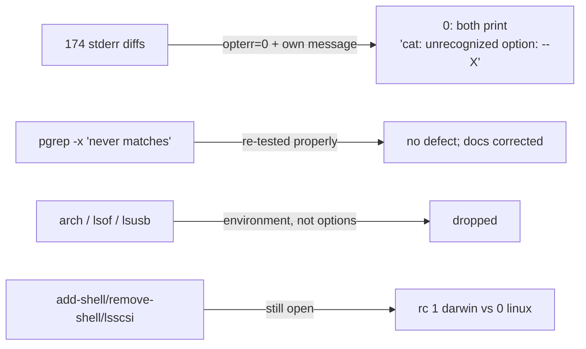

Working the platform audit in its own priority order cut the option-level differences from **174 stderr + 4 usage + 3 exit + 3 output** to **one genuine class left** (three applets' exit codes), plus two classes that turned out not to be option bugs at all.



## 1. The unknown-option message — fixed

`libbb/getopt32.c` used to let the platform libc print the diagnostic, so glibc, musl and Apple's libc each worded it differently and named a different program. Now `opterr = 0` before the loop and busybox prints its own:

```c
if (c == '?') {
	const char *bad = (optind > 0 && argv[optind - 1]) ? argv[optind - 1] : "?";
	bb_error_msg("unrecognized option: %s", bad);
	goto error;
}
```

Verified identical on both: `cat: unrecognized option: --nosuchopt-zz`, same exit code, same usage dump. `--help` still works (busybox expands it itself before getopt runs).

`head` and `awk` parse with libc `getopt()` on purpose (they need order preservation), so both got `opterr = 0` and now print only the usage text — identical on both platforms.

Gate it with:

```sh
for a in cat awk head grep sort find; do
	printf '%-6s ' "$a"; busybox "$a" --nosuchopt-zz 2>&1 | head -1
done
```

## 2. `pgrep -x` — was never broken

The earlier claim that `-x` cannot match on Darwin was a harness error (a variable set inside a backgrounded `&&` chain, and a symlink not named after an applet). With a real symlink both platforms match identically; only `-a` differs, printing the full argv on Darwin and `argv[0]` on Linux. Docs corrected.

## 3-5. Reclassified or open

- `arch` prints `arm64` on Darwin and `aarch64` on Linux — that is the platform answering, not an option difference. `lsof`/`lsusb` reflected the machine's processes and devices. **Dropped from the list.**
- `fdisk`, `ip`, `mkpasswd` `--help` text still differs: config-gated option surface.
- `add-shell`, `remove-shell`, `lsscsi` still exit 1 on Darwin and 0 on Linux for an unknown option. Same source, so the next step is to read those three applets' option loops rather than guess; a usage error should be 2 on both.

Re-measure after any further change with the audit pair:

```sh
./tests/platform-probe.sh build/deep-darwin/busybox > /tmp/d.probe
docker run --rm -v "$PWD:/w:ro" almalinux:9 bash /w/tests/platform-probe.sh \
	/w/build/deep-linux-arm64/busybox > /tmp/l.probe
./tests/platform-diff.sh /tmp/d.probe /tmp/l.probe
```
