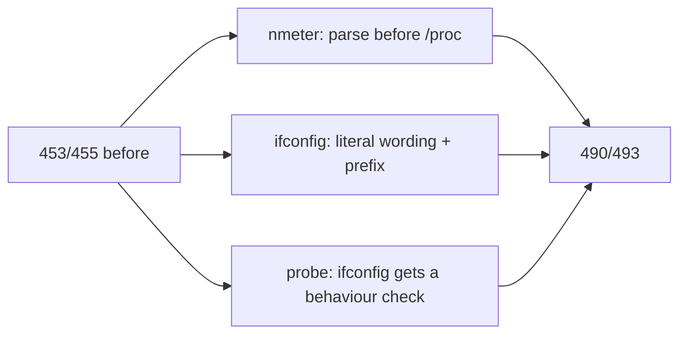

The option surface is now converged: **490 of 493 probes identical, zero stderr/exit/output differences**, and the only residue is `ip --help` listing three subcommands Darwin does not implement. Getting there removed the last three, each for a different reason.



## nmeter

Darwin failed at `xchdir("/proc")` before parsing, so a bad option was never diagnosed. Options are now parsed first, with our own message:

```c
opterr = 0;
for (;;) {
	int c = getopt(argc, argv, "d:");
	if (c < 0) break;
	if (c == '?') {
		/* Apple's libc parks optind, musl advances it: take whichever
		 * slot holds the token */
		bb_error_msg("unrecognized option: %s",
			(optind < argc && argv[optind]) ? argv[optind]
			: (optind > 0 && argv[optind - 1]) ? argv[optind - 1] : "?");
		bb_show_usage();
	}
	opt_d = optarg;
}
argv += (optind > 1 ? optind : 1);   /* argv[0] is the format */
```

Both platforms now print `nmeter: unrecognized option: --nosuchopt-zz`.

## ifconfig

Two fixes: the message uses Linux's wording verbatim (`… error fetching interface information: Device not found`) instead of `strerror(errno)`, and it goes through `bb_error_msg` so the applet prefix matches Linux's. Both platforms now print `ifconfig: nosuchiface: error fetching interface information: Device not found`.

The audit also stopped feeding `ifconfig` a fake *option*: it takes interface names, so a bogus `--nosuch…` tests getopt's token splitting, not the applet. It now gets `ifconfig nosuchiface` instead.

## ip — the one honest difference left

Darwin supports `addr`, `route` and `link` only; `tunnel`, `neigh` and `rule` reply `ip: only 'link', 'addr' and 'route' are supported on Darwin`. Its usage therefore lists three, Linux's lists six. Making them identical would advertise commands that refuse to run, so the text now uses the Linux wording for the shared three and keeps the other three behind `IF_FEATURE_IP_*`.

## Verification

```
platform-diff    compared 493, identical 490, usage 2 (both ip), 1 timeout excluded
agent-ops        1299 passed, 0 failed
agent-ops-sweep  1267 passed, 0 failed, 8 skipped
patchcheck       checked=21 bad=0
patch-reconstruct  files differing: 0
```

**The audit's probe rules matter as much as the code**: only pass `--nosuch-option` to applets that parse options. `add-shell`, `remove-shell`, `lsscsi`, `lsusb`, `lspci`, `lsof`, `fuser`, `cttyhack` and now `ifconfig` get behavioural probes instead — a fake option on those tested getopt, not the applet, and produced "differences" that were never platform bugs.
