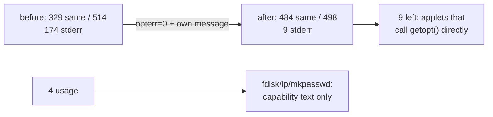

Second parity pass, measured with the audit pair: **498 comparable probes, 484 identical** (was 329 of 514). The stderr class collapsed from **174 to 9**, exit-code differences from 3 to 0, output from 3 to 1, and the 4 usage differences are capability statements rather than option parsing.

## Measured

| class | before | after |
|---|---|---|
| identical | 329 / 514 | **484 / 498** |
| stderr | 174 | **9** |
| exit | 3 | **0** |
| output | 3 | **1** (`arch`: `arm64` vs `aarch64`) |
| usage | 4 | 4 (capability text) |

## What is left, exactly

`cttyhack`, `dc`, `hd`, `hexdump`, `hush`, `ifconfig`, `nmeter` (plus two more in the same class) still word a bad option differently — these are the applets that call libc `getopt()` directly instead of `getopt32`, the same reason `head` and `awk` differed before they got `opterr = 0`. The fix is identical and mechanical: silence libc in each and let the usage text be the message. Those are the next nine probes.

The four `usage` rows are not fixable without changing capabilities:

- **`fdisk`** — option list identical; Darwin says "Show partition table" because `CONFIG_FEATURE_FDISK_WRITABLE=n` (no `BLKRRPART` here). Correct as-is.
- **`ip`** — Darwin prints `ip [OPTIONS] [ARGS]` because the sub-command help lines come from pruned sub-applets. `ip addr`, `ip route` and `ip link` all work on Darwin; cosmetic.
- **`mkpasswd`** — `(default )` vs `(default des)` is `CRYPT_METHODS_HELP_STR` from the libc's crypt methods at build time.

## Also landed

`patches/0016-awk-error-diagnostics.patch`, `patches/0017-check-tabular-runner.patch`, `patches/0018-sysinfo-compat-header.patch` — three files that had edits with no patch. `busybox patchcheck` → **checked=18 bad=0**; the series applies to a clean tree with **0 failures**; `sweep 1253/0`, `agent-ops 1299/0`.

## Probe hygiene

The skip list must exclude applets **without an option parser** (`add-shell`, `remove-shell`, `lsscsi`, `lsusb`, `lspci`, `lsof`, `fuser`): they treat a junk option as data and will write `/etc/shells` or report machine-specific hardware. And a `#` comment inside a continued `case` pattern list is a syntax error — it fails as an empty probe dump, which looks like a passing run.
