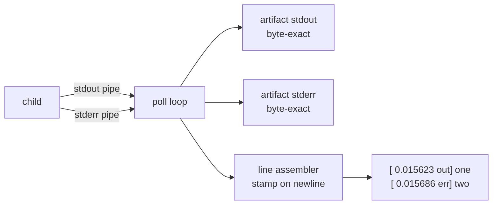

`run -t` / `sh --timestamps` print one interleaved stream in which every line carries the moment it was read and the stream it came from, dmesg style. `run -t -F json` puts the same data in a `timeline` array. The raw artifacts stay byte-exact, so evidence is untouched.



## Text form

```
$ busybox sh --timestamps -c 'echo one; echo two >&2; sleep 0.05; echo three'
run=R66 exit_code=0 timed_out=false cancelled=false duration_ms=80
timeline_lines=3 bytes=14 truncated=false
--- timeline ---
[   0.015623 out] one
[   0.015686 err] two
[   0.081766 out] three
```

Microsecond resolution (`CLOCK_MONOTONIC`) relative to the fork, `out`/`err` tagged so a merged line is never ambiguous, and the two `--- stdout ---` / `--- stderr ---` sections are replaced — otherwise the interleaving would be lost again.

## JSON form

```
$ busybox run -t -F json -- busybox sh -c 'echo hi'
{"schema":1,…,"timeline":[{"us":12119,"stream":"out","text":"hi"}],"timeline_truncated":false}
```

## What the ordering can and cannot promise

The two pipes are separate, so byte order *between* them is not recoverable — that is the known cost of pipes over a pty (§10 question 3). What is recoverable is the order in which this process read each **complete line**, and stamping at read time is that honest approximation. Within one stream the order is exact; across streams it is read order, which is the best a pipe-based capture can do.

## Details that matter

- A line with no trailing newline is flushed with a final stamp; a 5000-byte line stays one record.
- `--max-bytes` bounds the timeline the same way it bounds the view (`-B 8` gives one record plus `... [timeline truncated at 8 bytes] ...`).
- `--brief`, `--quiet`, `--timeout`, `--pgid` and `--format json` all compose with `-t`.
- `sh --timestamps` forwards to `run`, and `sh -c 'echo --timestamps'` still prints the literal string.
- Binary output does not crash the assembler; the bytes go to the artifact untouched.

Checks: `tests/agent-ops-sweep.sh` §24, 38 of them, green on darwin-arm64 and AlmaLinux 9.
