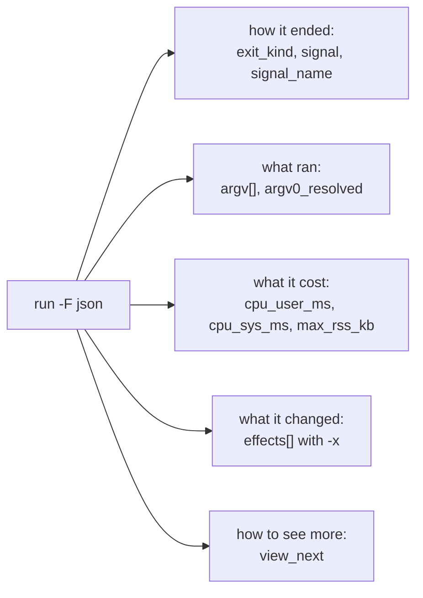

All nine metadata items are implemented in `run` (and so in `sh --format json`, which forwards). A model can now see how the process ended, what actually executed, what it changed, and how to read past a truncated view.



## The fields

| field | note |
|---|---|
| `exit_kind` | `exited` / `signalled` / `timed_out` / `cancelled` — `-1` alone no longer needs guessing |
| `signal`, `signal_name` | only when signalled; `15`, `TERM` |
| `argv[]`, `argv0_resolved` | real argument boundaries (the `cmd` string is space-joined) and what PATH or realpath resolved argv[0] to |
| `cpu_user_ms`, `cpu_sys_ms`, `max_rss_kb` | from `wait4`; `ru_maxrss` is bytes on Darwin and KiB on Linux, so it is divided on `__APPLE__` |
| `stdout_lines`, `stderr_lines`, `binary`, `final_newline`, `dropped_bytes` | output shape, in one pass over each artifact |
| `replay` | `cd '<cwd>' && '<argv0>' '<arg>' …`, POSIX single-quoted |
| `inputs_hash` | sha256 over NUL-separated argv plus the start cwd |
| `busybox_version` | parsed from `bb_banner` |
| `view_next` | `log -D <dir> R<n> -B <2×budget>`, only when the view was truncated |
| `effects[]`, `effects_scanned`, `effects_truncated` | with `-x/--effects`: `{op:"added"\|"changed"\|"removed", path, size}` from a bounded walk (depth 8, 20000 entries, 200 reported) of the run's cwd before and after |

## Verified

```
$ busybox run -F json -- busybox sh -c 'kill -TERM $$'
  → "exit_kind":"signalled","signal":15,"signal_name":"TERM"
$ cd DIR && busybox run -x -F json -- busybox sh -c 'printf hi > new.txt; printf changed > keep.txt'
  → "effects":[{"op":"changed","path":"keep.txt","size":8},{"op":"added","path":"new.txt","size":3}]
$ busybox run -B 5 -F json -- busybox sh -c 'seq 1 200'
  → "view_next":"log -D <dir> R4059 -B 10"
```

`agent-ops 1299/0`; `agent-ops-sweep 1311/0/8` on darwin, `1310/0/8` in almalinux:9 (one check skips as root); `patchcheck checked=22 bad=0`; `patch-reconstruct` files differing: 0.

## Two traps in the harness

- busybox `sed` has no `\|` in BRE, so the field extractors are three single-pattern helpers: `fs` (quoted string), `fn` (number), `fb` (boolean word). One alternation pattern returns empty and every check fails for the wrong reason.
- `ru_maxrss` units differ per platform; without the `__APPLE__` division the field reads 5,816,320 "KB".
