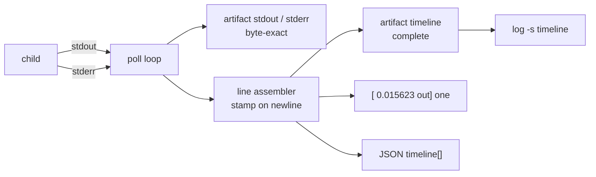

`run -t` / `sh --timestamps` print one interleaved stream where every line carries its read time and stream, and the same records are preserved in three places: the JSON `timeline` array, a `timeline` artifact beside `stdout`/`stderr`, and the version `log -s timeline` reads back. Raw artifacts stay byte-exact.



## Text form

```
$ busybox sh --timestamps -c 'echo one; echo two >&2; sleep 0.05; echo three'
run=R66 exit_code=0 timed_out=false cancelled=false duration_ms=80
timeline_lines=3 shown=3 truncated=false
--- timeline ---
[   0.015623 out] one
[   0.015686 err] two
[   0.081766 out] three
```

Microsecond `CLOCK_MONOTONIC` relative to the fork; `out`/`err` tagged so a merged line is never ambiguous. The two `--- stdout ---` / `--- stderr ---` sections are replaced — keeping them would lose the interleaving again.

## JSON keeps the timestamps

```
$ busybox run -t -F json -- busybox sh -c 'echo a; echo b >&2'
{…,"started_unix_us":1795372826626033,
 "timeline":[{"us":13134,"stream":"out","text":"a"},{"us":13177,"stream":"err","text":"b"}],
 "timeline_lines":2,"timeline_shown":2,"timeline_truncated":false}
```

`us` is µs since the fork; `started_unix_us` is the wall-clock origin, so a timeline can be aligned with other logs. `timeline_lines` vs `timeline_shown` says exactly how much of it you are seeing.

## Evidence outlives the response

Even with `-B 8`, where the view shows one line of five, `<dir>/timeline` holds all five. Read it back with `log`:

```
$ busybox log -D <dir> R7 -s timeline -m 'err]'
```

`-s` now takes `stdout`, `stderr`, `timeline` or `both`; anything else exits 2.

## The ordering limit, stated once

The two pipes are separate, so byte order *between* them is not recoverable — the known cost of pipes over a pty (§10 Q3). Read order of *complete lines* is what gets stamped: exact within a stream, read order across streams. The `out`/`err` tag is what keeps that honest.

Checks: `tests/agent-ops-sweep.sh` §24-25, 63 of them, green on darwin-arm64 and AlmaLinux 9.
