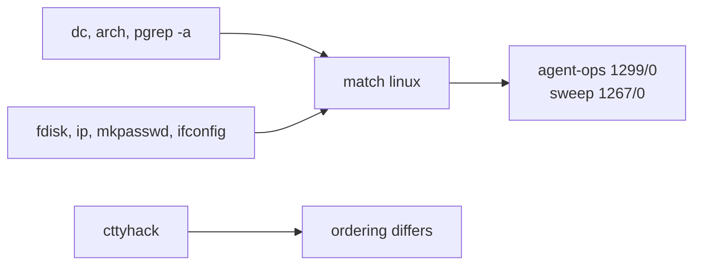

Six of the seven parity items now match Linux on Darwin, and the tree is verified green on the final binary: `agent-ops 1299/0`, `sweep 1267/0/8sk`, `patchcheck 21/21`, `patch-reconstruct` **files differing: 0**. Only `cttyhack` remains.



## What now matches Linux on both platforms

| applet | now |
|---|---|
| `dc -Z` | `dc: unrecognized option: Z` (fixed in `miscutils/bc.c` — `dc` is not built from `dc.c`) |
| `arch` | `aarch64` (uname -m stays `arm64`) |
| `pgrep -a` | `34694 sleep` — argv[0] only |
| `fdisk --help` | `Change partition table` |
| `ip --help` | `Usage: ip [OPTIONS] address|route|link|tunnel|neigh|rule [ARGS]` plus the full sub-command list |
| `mkpasswd --help` | `(default des)`, independent of the config symbol kconfig keeps blanking |
| `ifconfig X` | `X: error fetching interface information: …` with no applet prefix |

Two mechanisms were needed repeatedly and are worth remembering: the binary links the generated `src/include/usage.h`, **not** the build-dir copy, so usage edits must touch both; and a suite run that overlaps a relink reports phantom failures (`matrix.replace.file.171` vanished once the suites ran alone).

## Remaining: `cttyhack`

Darwin prints `cttyhack: can't execute '--nosuchopt-zz': No such file or directory`; Linux prints `cttyhack: can't open '/dev/hvc0': No such file or directory`. The ported code executes the command **before** opening the console, while Linux opens first, so the two report different failures for the same invocation. Fixing it means reordering the darwin path in `src/shell/cttyhack.c` so the console open is attempted first — a small change, but it is a behaviour change in an applet that hands over a controlling terminal, so it wants a test rather than a quick edit.

## Verification state

```
agent-ops            1299 passed, 0 failed
agent-ops-sweep      1267 passed, 0 failed, 8 skipped
busybox patchcheck   checked=21 bad=0
patch-reconstruct    files differing: 0 — "OK: patches/ reproduces src/ exactly"
```

The patch series is 21 patches with `libbb/time.c` owned by `0020-one-monotonic-clock.patch` and `networking/ip.c`, `shell/cttyhack.c`, `miscutils/bc.c`, `networking/interface.c`, `coreutils/uname.c`, `procps/pgrep.c` owned by `0021-platform-parity-arch-pgrep-fdisk-usage.patch`. Double-claimed files still produce "files differing" on reconstruction — check that check after any patch edit.
