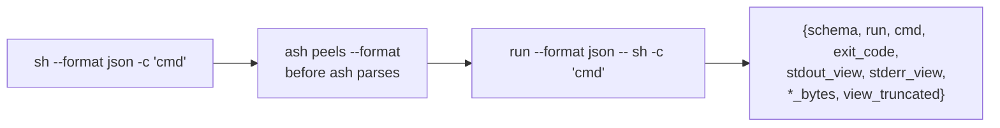

`sh --format json -c CMD` runs the script through `run` and prints exactly one schema-1 object carrying the child's exit status, both stream views and their byte counts. `--format text` prints `run`'s normal text summary; with no `--format` (and no `--timeout`) `sh` behaves as a plain shell.



## What the object contains

```
$ busybox sh --format json -c 'echo out; echo err >&2; exit 3'
{"schema":1,"run":"R50","cmd":"sh -c echo out; echo err >&2; exit 3","dir":"…/R50","pgid":11086,
 "exit_code":3,"timed_out":false,"cancelled":false,"capture_complete":true,"duration_ms":18,
 "stdout_bytes":4,"stderr_bytes":4,"view_truncated":false,"stdout_view":"out\n","stderr_view":"err\n"}
```

The process still exits with the child's status (3 here), so `sh --format json` is a drop-in for the command it wraps.

## Semantics worth knowing

- `--max-bytes N` bounds the *view*, not the capture: `stdout_bytes` stays the full size and `view_truncated` flips to `true`; a budget too small for even a prefix yields `"\n... [9 bytes] ...\n"` rather than a silent cut.
- `--capture-limit N` bounds the capture itself and sets `capture_complete:false`.
- `--timeout N` still works and now composes: exit 3 with `timed_out:true`, still a valid object.
- `--brief stdout|stderr|both` and `--brief-json` compose with `--format json` exactly as they do for `run`.
- Option peeling stops at `-c CMD`, a script path, or `--`, so `sh -c 'echo --format json'` prints the literal string.
- `--format xml` exits 2; `--format json` with no command exits 2.

## Both sides now speak the same shape

`run --format json` also gained a `"cmd"` field (the joined argv, additive per BUSYBOX-CONTRACT.md §7), so a captured `sh` and a captured command are readable the same way:

```
$ busybox run -F json -- busybox sh -c 'echo x'
{"schema":1,"run":"R51","cmd":"busybox sh -c echo x","dir":…,"pgid":…,"exit_code":0,…}
```

Checks: `tests/agent-ops-sweep.sh` sections 19-20, 62 of them, green on darwin-arm64 and AlmaLinux 9.
