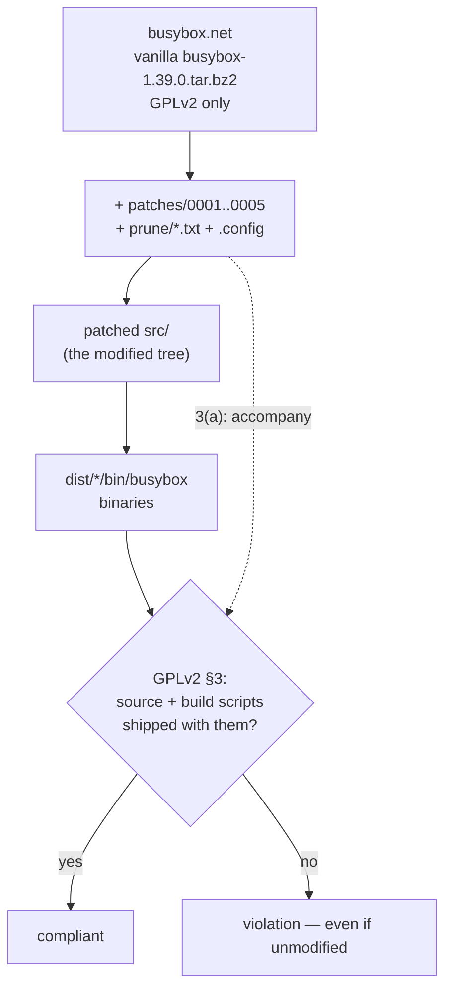

Yes — publishing a modified BusyBox together with its complete source is not merely allowed, it is the *expected* way to redistribute it, and busybox.net's own FAQ describes this repo's exact layout (vanilla tarball + a patch) as the recommended form. What is not allowed is shipping a binary without the corresponding source.

## What busybox.net actually says

From `https://busybox.net/license.html` (fetched 2026-11-22):

* "BusyBox is licensed under the GNU General Public License version 2."
* "If you distribute BusyBox without making the source code to the version you distribute available, you violate the license terms... **This requirement applies whether or not you modified BusyBox**."
* "If you modified the source, you have to distribute the modified source."
* The options are exactly GPLv2 §3(a)/(b)/(c); 3(a) — "putting exact BusyBox source and .config file you used to build the binary on the same medium... plus the scripts used to control compilation and installation" — is called "the most bullet-proof approach".
* "It doesn't have to be a single archive. Indeed, most people distribute modified sources in the form of unmodified `busybox-N.N.N.tar.bz2` archive and a set of patches which add features or fix problems."
* Developer's note: "Version 2 of the GPL is the only version of the GPL which current versions of BusyBox may be distributed under", while "some individual files may have more permissive licenses: 'GPL version 2 or later'".

The FAQ's firmware example is literally our layout: publish the upstream tarball URL plus a `.patch`.

## GPLv2 §2(b) — the clause about "the whole codebase"

§2(b) requires that any work "that in whole or in part contains or is derived from the Program... be licensed **as a whole** at no charge to all third parties under the terms of this License", and the next paragraph extends those permissions "to the entire whole, and thus to each and every part regardless of who wrote it". So a modified BusyBox must be distributed *entirely* under GPLv2 — you may not publish the parts you changed under a tighter licence, nor pick and choose.

Carve-out: sections that are genuinely separate works are unaffected when distributed separately, but as soon as they ship as part of the whole, the whole must be GPLv2 — unless they are GPL-compatible, which is why the BSD/MIT bits in `shell/ash.c`, `coreutils/od_bloaty.c` and `libbb/yescrypt/` are fine and simply keep their own notices.

## Two duties that are easy to miss

* **§2(a) modification notices.** Changed files must carry prominent notices saying so, with dates. Publishing `patches/` satisfies this in practice, and the README states it too.
* **§2(c) banner.** An interactive program must announce copyright, warranty and that it may be redistributed. `busybox` with no arguments prints "BusyBox is copyrighted by many authors... Licensed under GPLv2. See source distribution for detailed copyright notices" — do not strip it.

## Verdict for this repo

Publishing `dist/*/bin/busybox` plus the patched `src/`, `patches/0001..0005`, `prune/*.txt`, the per-target `.config` snapshots and `build.sh`/`build-all.sh` is compliant and is what the project asks for. Publishing the binaries alone is not.
