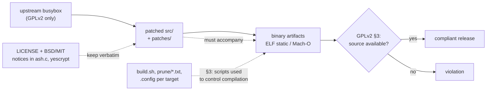

BusyBox is **GPLv2 only** — `src/LICENSE` states "Version 2 is the only version of this license which this version of BusyBox (or modified versions derived from this one) may be distributed under." Label the repository and package metadata `GPL-2.0`, never `GPL-2.0-or-later`.

Publishing the built binaries is permitted, but shipping them (GitHub Releases, containers, tarballs) makes you a distributor of GPLv2 object code, which triggers the source obligation for the **modified** tree.

## What must ship with the artifacts

GPLv2 §3 requires the complete corresponding source, and explicitly includes "the scripts used to control compilation and installation". Alongside each release:

* the full patched `src/` tree — commit it; an uncommitted clone means the release tag does not contain it
* `patches/`, `prune/*.txt`, and per-target `.config` snapshots
* `build.sh`, `build-all.sh`
* `LICENSE` unchanged

## Modification notices (§2(a))

`patches/0001` and `patches/0002` modify upstream files, so the publication must state prominently that the files were changed and when. Keeping patches as separate files plus the README section satisfies this.

## Do not strip these

Permissive third-party notices must survive: `shell/ash.c` keeps its BSD notice; `coreutils/{od,echo,env}.c`, `shell/math.c`, `libbb/yescrypt/*` carry BSD/MIT-style grants. All are GPLv2-compatible and must not be relabelled GPL-only.

## Not distributed by us

The Darwin binaries link Apple's `libSystem.B.dylib` and `libresolv.9.dylib` — OS components. The Linux binaries statically contain musl (MIT) and compiler-rt (Apache-2.0 WITH LLVM-exception), both GPL-compatible; note them in a NOTICE. zig and llvm-ar are build tools, not distributed.

## Enforcement context

The Software Freedom Conservancy has pursued BusyBox GPL compliance against distributors, so treat "binaries published, source available" as a hard rule. Do not add further restrictions (non-commercial clauses, extra EULAs) — GPLv2 §6 forbids it.
